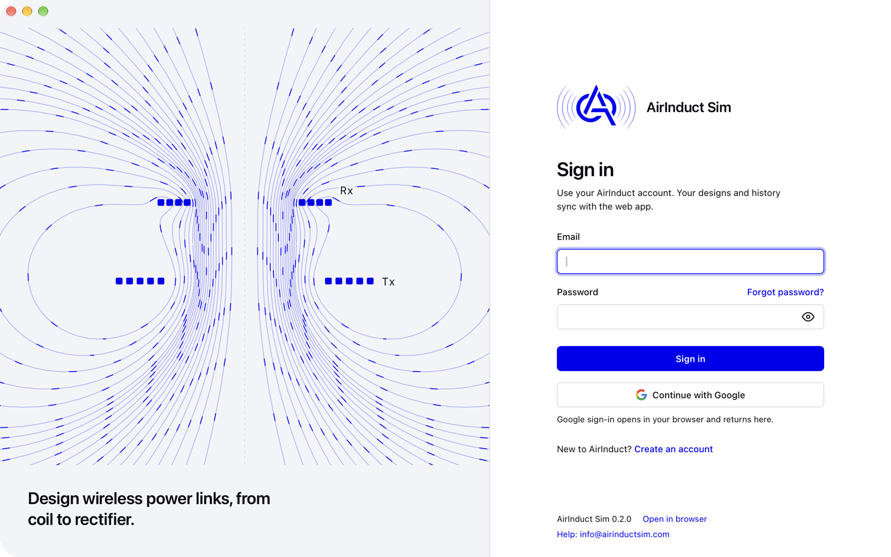

  

<h1 align="center">AirInduct Sim for desktop</h1>

  Design wireless power links, from coil to rectifier, in a native app for macOS, Windows and Linux.

  
  

  

AirInduct Sim is an engineering tool for inductive wireless power transfer (WPT): model the coil
pair, see the magnetic field, get mutual inductance and coupling, then carry the design through
matching, rectification, losses and safety checks. The desktop app runs the full
[AirInduct Sim](https://app.airinductsim.com) in its own window, with native menus, shortcuts,
file saving, notifications and automatic updates.

## Download

| Platform | Download |
|---|---|
| macOS, Apple Silicon (M1 and later) | [AirInduct Sim for Apple Silicon (.dmg)](https://airinductsim.com/download/mac-arm64) |
| macOS, Intel | [AirInduct Sim for Intel Macs (.dmg)](https://airinductsim.com/download/mac-x64) |
| Windows 10 / 11, 64-bit | [Installer (.exe)](https://airinductsim.com/download/windows) · [MSI package](https://airinductsim.com/download/windows-msi) |
| Linux x86_64 | [AppImage](https://airinductsim.com/download/linux-appimage) · [.deb](https://airinductsim.com/download/linux-deb) · [.rpm](https://airinductsim.com/download/linux-rpm) |

Every version, with release notes and checksums, is on the
[Releases page](https://github.com/airinduct-sim/desktop/releases). The app checks for updates
when it starts and installs them after you confirm.

### First launch

The installers are not code-signed yet, so your system asks you to confirm once.

* **macOS**: drag the app to Applications, then Control-click it and choose **Open**, then
  **Open** again. On macOS 15 and newer, if there is no Open button, go to **System Settings →
  Privacy & Security** and click **Open Anyway**.
* **Windows**: if SmartScreen says *Windows protected your PC*, click **More info**, then
  **Run anyway**.
* **Linux**: make the AppImage executable and run it:
  `chmod +x AirInduct-Sim_*.AppImage && ./AirInduct-Sim_*.AppImage`.
  The .deb and .rpm install with your package manager.

## What you can do with it

**Coil simulation**
* Eight coil-pair topologies, circular and square: Helmholtz and double-turn coil (DTC)
  transmitters and receivers in every combination.
* Magnetic field maps in 2D and 3D, mutual inductance, self-inductance and coupling factor k.
* Multi-coil arrays with superposed fields, and side-by-side comparison of results.
* A coil library to save, reuse and import coil designs.

**From coil to system**
* **Optimizer**: search coil geometries for a target coupling, efficiency or robustness to offset.
* **Link designer**: compare compensation topologies, sweep the air gap and follow the power chain end to end.
* **Rectifier** analysis for the receive side.
* **Heat and losses** (thermal), **ferrite shield** design and **tolerance and yield** studies.
* **Exposure checker** against ICNIRP reference levels, and **foreign-object** heating checks
  based on the Qi specification.
* **Measure vs. simulation**: bring in bench measurements and compare them with the model.

**Exports**: CSV, XLSX, DOCX and PDF reports, Touchstone, LTspice schematics, MATLAB and
Python scripts, or everything at once as a ZIP.

## What the desktop app adds

* A native window with a full menu bar and keyboard shortcuts (Cmd/Ctrl+1–5 jump to the
  dashboard, coil library, optimizer, rectifier and history).
* Exports open a native Save dialog, so files go straight into your project folder.
* Notifications when a long job or optimisation finishes while the window is in the background.
* The window remembers its size and position and reopens the page you were on.
* `airinduct-sim://` links open a tool directly in the app, for example `airinduct-sim://optimizer`.
* Google sign-in runs in your default browser and hands the session back to the app.
* A clear offline screen that reconnects by itself when the network returns.
* Signed automatic updates.

The app runs the same AirInduct Sim as the web, on the same servers: one account, the same
results, and your designs and history in sync. An internet connection is required.

## System requirements

| | Minimum |
|---|---|
| macOS | 11 Big Sur or newer, Apple Silicon or Intel |
| Windows | 10 or 11, 64-bit (Microsoft Edge WebView2 is installed automatically if missing) |
| Linux | x86_64 with WebKitGTK 4.1: Ubuntu 22.04+, Debian 12, Fedora 38+ |
| Memory | 4 GB RAM, 8 GB recommended for 3D field views |
| Network | Internet connection |

## Support

* Questions, problems and feature ideas: [open an issue](https://github.com/airinduct-sim/desktop/issues/new/choose)
  or email [info@airinductsim.com](mailto:info@airinductsim.com).
* Security reports: see [SECURITY.md](SECURITY.md).
* Website: [airinductsim.com](https://airinductsim.com) · Web app: [app.airinductsim.com](https://app.airinductsim.com)

## License

Installers only. AirInduct Sim, including the desktop app, is proprietary software; its source
code is not published in this repository. Use of the app is subject to the
[Terms of Service](https://airinductsim.com/terms) and [Privacy Policy](https://airinductsim.com/privacy).

© 2026 AIRINDUCT TECH - FZCO, Dubai Silicon Oasis, Dubai, UAE.
